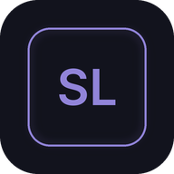

# SiLengkap 2.0



**Transkripsi video, berita terverifikasi, analisa Bitcoin, radio, dan gim dalam satu aplikasi Android.**
Prinsip: **Fast · Accurate · Cool**.

| Bagian | Isi | Berjalan di |
|---|---|---|
| **Aplikasi SiLengkap 2.0** (`android/` + tampilan `web/`) | Menu, tampilan, radio, gim, **TranscriptBot 4** (di HP) | HP Android (APK) |
| **Rheus LLM** (`cloud/rheus-llm/`) | Obrolan AI & ringkasan AI: Llama 3.2 3B + konteks internet | Cloudflare Workers AI, gratis |
| **Rheus Cloud** (`rheus/` + `.github/workflows/rheus-cloud.yml`) | "Otak": mengumpulkan, memverifikasi, dan mempelajari berita; analisa Bitcoin; melatih model TranscriptBot | GitHub Actions, gratis, **tanpa server yang bisa tertidur** |

## ⚡ Arsitektur Rheus Cloud (kenapa sekarang cepat)

Versi sebelumnya bergantung pada server gratis. Server itu tertidur, sehingga aplikasi "loading" lama, bahkan lebih dari 1 menit. Sekarang **tidak ada server yang perlu dibangunkan**:

1. **Setiap ±30 menit**, GitHub Actions menjalankan `python -m rheus.cloud`. Proses ini mengambil puluhan sumber berita secara paralel, membuang hoaks, menggabungkan berita yang sama, belajar dari teks baru, lalu menghitung analisa Bitcoin.
2. Hasilnya berupa file JSON kecil (beberapa KB). File itu diterbitkan ke branch `rheus-data` dan disajikan lewat **CDN** (raw.githubusercontent.com & jsDelivr).
3. Aplikasi langsung **menampilkan salinan tersimpan seketika**, lalu mengunduh versi terbaru (±0,2–1 detik). Ada dua CDN; bila CDN pertama lambat, aplikasi otomatis memakai yang kedua.

**Memori sementara 48 jam:** Rheus menyimpan berita di `memory.json.gz`. Setiap putaran, berita baru ditambahkan dan **berita yang berumur lebih dari 48 jam dihapus otomatis**. Cara ini lebih efisien daripada menghapus semuanya setiap 2 hari: data tetap segar setiap 30 menit, tetapi tidak pernah lebih tua dari 2 hari. Klaim hoaks disimpan 30 hari. Otak ML (`brain.pkl`) disimpan permanen, jadi terus belajar.

> **Penting:** jadwal otomatis GitHub hanya berjalan dari branch utama (`main`). Merge PR ini agar Rheus Cloud berjalan sendiri setiap 30 menit. Sebelum itu, workflow **Rheus Cloud** bisa dijalankan manual dari tab Actions.

## ✅ Akurat & bebas hoaks

- **Daftar media kredibel** (Indonesia & AS): `rheus/rheus/sources.py`.
- **Terverifikasi:** berita diberi lencana ✔ bila diliput **≥2 media kredibel** yang berbeda.
- **Saring hoaks:** klaim yang sudah dibantah **TurnBackHoax (Mafindo)** dan **Cek Fakta Tempo** dicocokkan dengan MinHash LSH. Berita yang mengulang klaim hoaks dibuang, dan jumlahnya ditampilkan ("x hoaks disaring").
- **Saring clickbait:** judul umpan klik tidak bisa menjadi headline hot.
- **Headline hot hanya dari media kredibel.** Berita lain tetap tampil dengan label "Belum terverifikasi".

## Menu

| Menu | Isi |
|---|---|
| 🎬 Transkripsi Video | Link YouTube → transkrip rapi + ringkasan cepat (di HP) + **Ringkasan AI** oleh Rheus. Pilihan bahasa: terjemahkan ke Indonesia, bahasa asli, atau English |
| 💹 Berita Finansial | Saham, valas, kripto, perbankan, emas, makro — pilihan 🇮🇩 Indonesia / 🇺🇸 USA |
| 💻 Berita Teknologi | AI, gadget, aplikasi, keamanan siber, startup, game, sains — pilihan 🇮🇩 / 🇺🇸 |
| 📈 Prediksi Arah Bitcoin | Harga live, grafik 24j/7h/30h, arah, probabilitas, uji balik |
| 📰 Berita Utama | Nasional & Internasional (Militer, Ekonomi, Hubungan Antarnegara, Geopolitik) |
| 🔥 Berita Viral | Indonesia / USA, per media sosial & kategori |
| 📻 Radio | Stasiun gratis Indonesia & USA — tetap berbunyi saat layar mati, sambung ulang otomatis |
| 🎵 Musik Online | **Pemutar mini** YouTube Music yang melayang di dalam SiLengkap |
| 🎮 Gim | 9 gim dengan musik & efek suara (**offline**) |
| ✨ Tanya Rheus | Obrolan AI (Llama 3.2 3B + internet) dengan sumber bernomor |

Semua berita dibuka **di dalam aplikasi** dengan **Mode Baca** otomatis (isi artikel bersih tanpa iklan; tombol **Aa** untuk kembali ke halaman asli). Tema **gelap / terang / otomatis** ada di Pengaturan.

## 🆕 Yang baru di 2.0

### 📻 Radio tidak lagi putus-putus
Dulu radio diputar oleh pemutar web di dalam aplikasi. Pemutar itu menolak aliran `http://`, tidak mengenal sebagian format, dimatikan Android saat layar mati, dan tidak pernah menyambung ulang. Sekarang radio diputar **ExoPlayer (Media3)** di layanan latar belakang (`RadioService.kt`):
- memutar MP3, AAC/AAC+, OGG, **HLS**, dan daftar putar `.pls`/`.m3u`, termasuk aliran `http://`;
- **menyambung ulang otomatis** saat sinyal putus (jeda bertahap 1–15 detik, pindah ke alamat cadangan, dan langsung menyambung saat internet kembali);
- notifikasi dengan tombol putar/jeda, kontrol dari layar kunci dan headset, serta judul lagu yang sedang diputar;
- daftar stasiun hanya berisi stasiun yang **lolos pengecekan terakhir** Radio Browser, diperbarui setiap 6 jam.

### 🎬 Mengatasi "429 – YouTube membatasi permintaan"
YouTube membatasi per alamat IP. Di data seluler, banyak pengguna berbagi satu IP, sehingga batas itu cepat tercapai. Yang dilakukan aplikasi sekarang:
1. **Simpanan di HP:** video yang pernah ditranskripsi tidak pernah meminta ke YouTube lagi.
2. **Berperilaku seperti aplikasi sungguhan:** cookie dan identitas pengunjung dipertahankan.
3. **Ganti jalur:** bila dibatasi, aplikasi menunggu sesuai permintaan YouTube lalu mencoba klien Android → iOS → halaman web.
4. **Lewat Rheus Cloud:** bila HP tetap dibatasi, subtitle diambil server Rheus LLM (alamat IP lain).
5. Bila semuanya gagal, muncul petunjuk jelas (tunggu 1–2 menit, ganti Wi-Fi/data, atau mode pesawat sebentar).

### 🧠 Rheus sekarang LLM
"Tanya Rheus" dan "Ringkasan AI" memakai **Llama 3.2 3B Instruct** yang dijalankan di cloud (**Cloudflare Workers AI**, paket gratis). Kodenya di `cloud/rheus-llm/worker.js`. Sebelum menjawab, Rheus mengambil konteks segar dari internet: berita 48 jam terakhir dari Rheus Cloud (sudah disaring hoaks), Wikipedia, dan harga Bitcoin live. Jawaban menyertakan nomor sumber yang bisa diketuk.

**Cara mengaktifkan (sekali saja, gratis):**
1. Daftar di https://dash.cloudflare.com (tanpa kartu kredit).
2. Salin **Account ID** (halaman Workers & Pages, kolom kanan).
3. Buat token di **My Profile → API Tokens → Create Token → template "Edit Cloudflare Workers"**, lalu tambahkan izin **Account → Workers AI → Read**.
4. Di GitHub: **Settings → Secrets and variables → Actions → New repository secret**, isi `CLOUDFLARE_ACCOUNT_ID` dan `CLOUDFLARE_API_TOKEN`.
5. Jalankan workflow **Rheus LLM** dari tab Actions. Dalam ±30 menit aplikasi menemukan alamatnya sendiri lewat Rheus Cloud — APK tidak perlu diunduh ulang.

Sebelum diaktifkan, Tanya Rheus tetap berfungsi dengan mesin pencari di HP, dan tombol Ringkasan AI tidak ditampilkan.

> **Catatan jujur:** kualitas jawaban setara model 3 miliar parameter: bagus untuk merangkum dan menjawab dari konteks, tetapi bisa keliru pada penalaran rumit. Paket gratis Cloudflare dibatasi ±10.000 "neuron" per hari (kira-kira ratusan jawaban); bila habis, aplikasi otomatis kembali ke mesin pencari.

### 🎮 Gim 2.0
Sembilan gim, semuanya dengan **efek suara dan musik chiptune buatan sendiri** (disintesis langsung, tanpa file audio) dan tombol bisu:
**Petualangan Rheu** (platformer, level acak), **Invasi Galaksi** (tembak-tembakan), **Kepak Sayap** (ketuk untuk terbang), **Dino Lari** (lari tanpa akhir, siang-malam, lompat ganda), **Pecah Bata**, **Ular Neon**, **Ular Tangga**, **Sudoku**, **Minesweeper**. Gim arkade berjalan di mesin `web/games/engine.js`: 60 fps, partikel, guncangan layar, rekor per gim, jeda otomatis.

### 🎵 Musik Online: pemutar mini
YouTube Music dibuka sebagai **jendela kecil di bagian bawah layar** (`MusicPanel.kt`). Anda tetap bisa berpindah menu, membaca berita, atau bermain gim sementara musik berjalan. Tombol ⤢ memperbesar panel, ✕ menutupnya, dan radio otomatis dijeda saat musik dibuka. Batasan dari pihak Google, bukan dari aplikasi:
- Musik **dijeda saat SiLengkap keluar dari layar** atau layar mati. Putar di latar belakang adalah fitur YouTube Premium, dan aplikasi ini sengaja tidak mengakalinya. Untuk musik gratis yang tetap berbunyi saat layar mati, pakai menu Radio.
- Google tidak mengizinkan login di tampilan seperti ini, jadi tombol **Masuk** membuka Chrome. Login itu tidak terbawa ke panel, sehingga playlist pribadi dan Premium tidak terbaca di dalamnya.

### 🇺🇸 Berita AS
Berita Finansial dan Berita Teknologi punya pilihan Indonesia / USA. Berita AS memakai media AS (Reuters, CNBC, Bloomberg, TechCrunch, The Verge, dll.), dengan saringan clickbait, lencana Terverifikasi (≥2 media kredibel), dan headline hot hanya dari media kredibel yang sama seperti berita Indonesia. Isinya berbahasa Inggris. Saringan hoaks untuk berita AS belum ada, karena database klaim hoaks yang dipakai (TurnBackHoax, Cek Fakta Tempo) berbahasa Indonesia.

### 🌐 Pilihan bahasa transkripsi
Di halaman Transkripsi ada tiga pilihan: **Terjemahkan ke Indonesia** (bawaan), **Bahasa asli**, dan **English**. Terjemahan dilakukan oleh YouTube (terjemahan otomatis), bukan oleh Rheus, jadi kualitasnya mengikuti YouTube. Mengganti pilihan setelah hasil muncul langsung memproses ulang. Perapian tanda baca dan ringkasan cepat TranscriptBot dilatih untuk Bahasa Indonesia, jadi untuk video berbahasa lain aplikasi menampilkan catatan dan menyarankan **Ringkasan AI**, yang selalu menulis dalam Bahasa Indonesia.

## 🎬 Transkripsi cepat (kenapa tidak macet lagi)

Dulu prosesnya: HP membuka halaman YouTube (berat, ±1 MB), mengirim subtitle ke server yang mungkin sedang tidur, lalu menunggu. Proses itu bisa "macet di 25%". Sekarang:

1. **Subtitle** diambil langsung dari endpoint player YouTube dengan 2 permintaan kecil (`YouTubeTranscript.kt`). Halaman video hanya dipakai sebagai cadangan. Setiap permintaan punya batas waktu (7 dtk sambung / 12 dtk baca), dan seluruh proses dibatasi 30 dtk, sehingga **tidak pernah macet tanpa pesan**.
2. **TranscriptBot 4 berjalan di HP** (`web/transcriptbot.js`). Ini port JavaScript dari versi Python. Model ML tanda baca & huruf kapital dilatih Rheus Cloud dan dibundel di APK. Hasilnya **identik 100%** dengan versi Python (`eval/parity_tb3.py`). Video ±15 ribu kata selesai diolah dalam ±0,1–0,3 detik.
3. Video yang pernah dibuka disimpan di cache, jadi membukanya lagi langsung selesai.

Aplikasi menampilkan tahap proses dan stopwatch ("Selesai dalam x detik").

---

## 🧠 Rheus
Kode Python di folder `rheus/`. Ia dibangun dengan library open-source dari GitHub:

| Library | Dipakai untuk |
|---|---|
| [FastAPI](https://github.com/fastapi/fastapi) + [Uvicorn](https://github.com/encode/uvicorn) (uvloop) | API async yang cepat |
| [httpx](https://github.com/encode/httpx) | Mengambil puluhan sumber sekaligus, paralel |
| [lxml](https://github.com/lxml/lxml) | Parser RSS berbasis C |
| [River](https://github.com/online-ml/river) | **Machine learning online**: model belajar terus dari setiap informasi baru |
| [NumPy](https://github.com/numpy/numpy) | Analisa Bitcoin, TextRank, prediksi tanda baca |
| [datasketch](https://github.com/ekzhu/datasketch) | MinHash LSH untuk menggabungkan berita yang sama dengan cepat |
| [rank_bm25](https://github.com/dorianbrown/rank_bm25) | Pencarian untuk "Tanya Rheus" |
| [orjson](https://github.com/ijl/orjson) | JSON cepat |
| [youtube-transcript-api](https://github.com/jdepoix/youtube-transcript-api) | Subtitle YouTube (versi web) |

### Prototipe machine learning: makin akurat setiap mendapat informasi

`rheus/rheus/learn.py` berisi tiga model online. Setiap model belajar satu contoh demi satu contoh.

- **Model tanda baca:** mengembalikan titik dan koma ke subtitle yang tidak bertanda baca. Model ini dilatih **self-supervised**: dari setiap teks berita bertanda baca yang masuk, tanda bacanya dibuang, model menebak, lalu belajar dari jawaban aslinya. Tidak ada pelabelan manual.
- **Model huruf kapital:** mempelajari bentuk penulisan yang benar dari teks yang rapi (jakarta → Jakarta, whatsapp → WhatsApp).
- **Model kategori berita:** dilatih dari "label lemah" (asal feed + kata kunci yang dicek isinya), lalu menebak kategori berita lain yang tidak berlabel.

Akurasi diukur **prequential**: setiap contoh baru ditebak dulu, baru dipelajari. Jadi angka akurasinya jujur, dan riwayatnya bisa dilihat di `GET /v1/learn`. Otak disimpan berkala ke disk.

> **Dua lapis Rheus:** model kecil di atas (tanda baca, huruf kapital, kategori) terus belajar dari berita dan dipakai untuk merapikan transkrip di HP. Untuk percakapan dan ringkasan AI, Rheus memakai LLM Llama 3.2 3B di cloud (lihat "Rheus sekarang LLM").

### API (opsional)

Server FastAPI (`rheus.app`) tetap tersedia untuk pengembangan. Aplikasi tidak lagi memerlukannya.

| Endpoint | Isi |
|---|---|
| `GET /v1/health` | Status |
| `GET /v1/news/utama` | Berita Utama (nasional, internasional + kategori) |
| `GET /v1/news/finansial` | Berita Finansial |
| `GET /v1/news/viral?region=id\|us` | Berita Viral (platform & kategori) |
| `GET /v1/btc?tf=24j\|7h\|30h` | Analisa Bitcoin + uji balik |
| `GET /v1/radio?region=id\|us` | Stasiun radio |
| `POST /v1/transcript` | `{url}` → subtitle + TranscriptBot 3 |
| `POST /v1/transcript/process` | Subtitle dari HP → TranscriptBot 3 |
| `GET /v1/ask?q=…` | Tanya Rheus |
| `GET /v1/learn` | Statistik pembelajaran |


---

## 🤖 TranscriptBot 3

Fitur baru di versi 3: **transkrip lengkap yang dirapikan**. Prosesnya:
1. Kata pengisi dibuang dan kata tidak baku dibakukan.
2. Model ML mengembalikan titik dan koma.
3. Huruf kapital diterapkan di awal kalimat dan pada nama diri.
4. Angka diubah menjadi digit.
5. Teks dibagi ke paragraf dengan stempel waktu.

Ringkasannya memakai pemotongan kalimat ucapan dari v2, teks yang dirapikan model ML, TextRank versi NumPy, dan MMR.

---

## 📊 Hasil verifikasi

Semua angka di bawah berasal dari GitHub Actions (`.github/workflows/rheus.yml`, November 2026) dengan **data sungguhan**. Untuk menjalankannya ulang: `python eval/eval_v3.py`, `python eval/bench_v2.py`, `node eval/btc_backtest.js`.

**Pelatihan awal:** 1.188 ringkasan artikel Wikipedia Indonesia + 123 deskripsi berita, total 167 ribu kata. 20% teks Wikipedia disisihkan sebagai data uji dan tidak pernah dipelajari.

**TranscriptBot 3 vs 2.0: kerapian transkrip lengkap** (diuji pada data yang tidak pernah dipelajari)

| | Titik F1 | Koma F1 | Huruf kapital nama diri | **Skor kerapian** |
|---|---|---|---|---|
| v2.0 | 0,271 | 0 | 0 | 0,090 |
| **v3** | **0,612** | **0,328** | **0,495** | **0,478 (5,3x)** |

Skor kerapian adalah rata-rata dari tiga angka di sebelahnya. Versi 2.0 tidak punya fitur transkrip rapi, jadi koma dan kapitalnya bernilai nol.

**Ringkasan:** v3 ROUGE-L 45,6 vs v2 45,5. Hasilnya **setara**. Ringkasan berbasis pemilihan kalimat sudah dekat batas atas metodenya, jadi ringkasan tidak naik 5x.

**Kecepatan Rheus 2 (server) vs 1.0 (diolah di HP)**

| | v1 di HP | v2 server | Peningkatan |
|---|---|---|---|
| Berita kripto | 653 ms | 6,8 ms | 96x |
| Berita utama/dunia | 385 ms | 6,8 ms | 57x |
| Berita viral | 314 ms | 5,1 ms | 62x |
| Analisa Bitcoin | 511 ms | 1,2 ms | 426x |
| Hitungan Bitcoin saja (kalibrasi + uji balik) | 67 ms | 19,9 ms | 3,4x |

Kenaikan besar di baris berita dan Bitcoin terjadi karena server **menyiapkan data di latar belakang**. Untuk hitungan murni, peningkatannya ±3,4x (NumPy + algoritma uji balik inkremental yang hasilnya dibuktikan identik).

**Pembelajaran online**
- **Model tanda baca:** F1 titik naik dari 0,60 (setelah 20 ribu kata) ke 0,82 (setelah 160 ribu kata). Angka ini diukur prequential: setiap contoh ditebak sebelum dipelajari.
- **Model kategori:** akurasi ±83–89% pada contoh berlabel yang belum pernah dilihat.

**Prediksi Bitcoin (uji balik 2 tahun):** tebakan arah **tidak lebih baik dari tebakan dasar**. Aplikasi menampilkan hasil ini apa adanya dan menurunkan keyakinan ke "rendah". Bukan saran keuangan.

**Keterbatasan**
- **Kategori berita viral:** hanya diberikan bila yakin. Akibatnya ±60–70% berita masuk "Lainnya". Ini disengaja: lebih baik tidak berkategori daripada salah kategori.

## 📲 APK Android

Unduh **SiLengkap.apk** dari https://github.com/airputihsegarmantap-blip/Transkripsi-/releases/tag/apk-terbaru.

Setiap kali APK dibangun, model TranscriptBot terbaru diunduh dari Rheus Cloud dan dibundel ke dalam APK.

## Pengembangan

```bash
pip install -r rheus/requirements.txt pytest
python -m pytest rheus/tests                     # uji otomatis
cd rheus && python -m rheus.train --wiki-pages 2000   # pelatihan awal
uvicorn rheus.app:app --reload                   # jalankan server (port 8000)
python -m rheus.cloud --out /tmp/v2              # satu putaran Rheus Cloud
python -m rheus.export_js ../web/tb3-const.js    # perbarui konstanta TranscriptBot versi HP
```

## Struktur

```
rheus/                 # Rheus
  rheus/cloud.py       #   satu putaran Rheus Cloud (dipanggil GitHub Actions)
  rheus/sources.py     #   media kredibel, cek fakta, clickbait
  rheus/app.py         #   API (opsional)
  rheus/learn.py       #   machine learning online (River)
  rheus/transcriptbot.py
  rheus/news.py, btc.py, radio.py, knowledge.py, youtube.py, train.py
  tests/               #   uji otomatis
  Dockerfile
web/                   # tampilan aplikasi (dibundel di APK)
  app.js, silengkap.css, config.js, games/
  transcriptbot.js, tb3-const.js   # TranscriptBot 3 di HP
android/               # pembungkus Android
eval/                  # evaluasi & benchmark (+ versi lama di eval/baseline untuk pembanding)
```
